# AD8232 心电图监测传感器模块

## 简介

在本教程中，我们将讲解让AD8232 心电图监测传感器模块正常运行的基础操作。首先，我们会对该模块及其各项功能进行概述；随后，演示如何将其连接到你常用的微控制器，并介绍如何通过 Arduino和Processing 软件实现数据可视化。

## 元件知识

AD8232 是一款精巧的小型芯片，用于测量心脏的跳动。这种跳动可绘制成心电图（ECG）。心电图技术可辅助诊断各类心脏病症。现就相关声明说明如下：

**注意：** 本设备不用于诊断或治疗任何疾病。

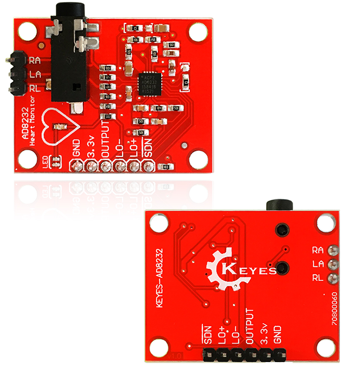

## 读懂心电图

总体而言，我们来了解一下心电图所反映的内容以及我们如何检测到它。心电图主要分为两个基础间期，即 PR 间期和 QT 间期，具体说明如下。

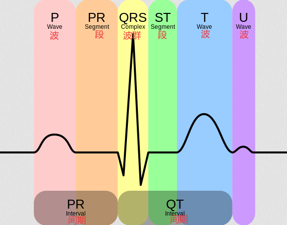


**PR 间期**

PR 间期是电脉冲从右心房传导至左心房时产生的初始波形。右心房是最先接收到电脉冲的心腔。该电脉冲会使心腔发生 “去极化”，进而促使其收缩，将来自上腔静脉和下腔静脉的缺氧血泵入右心室。当电脉冲传导至心脏上部时，会继而触发左心房收缩。左心房负责接收肺部输送来的新鲜含氧血，并通过左、右肺静脉将其输送至左心室。在示意图中，肺静脉呈现为红色，这是因为它们负责输送含氧血；而它们仍被称作静脉，是因为静脉的定义是将血液输送回心脏的血管。这就是科学原理！

**QT 间期**

QT 间期的相关机制十分值得探究。QRS 波群是一个复杂的电生理过程，会在心电监护仪上产生标志性的搏动信号。在 QRS 波期间，双侧心室开始收缩泵血。右心室将缺氧血通过左、右肺动脉泵入肺部。在示意图中，肺动脉呈现蓝色，因其内部流动的是缺氧血；但它们仍被称作动脉，原因是动脉的定义为将血液从心脏输送出去的血管，这便是科学的严谨之处。与此同时，左心室也开始将富含氧气的新鲜血液通过主动脉泵送至全身各处。
心室初步收缩后便进入 ST 段。这一阶段的电活动相对平稳，此时心室处于等待复极的状态。最终出现 T 波，代表心室开始主动复极，也就是舒张。这一舒张过程使心室恢复初始状态，以便再次接受心房泵入的血液。

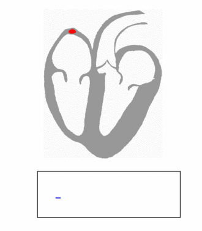

## 接线图

我们将把 AD8232 扩展板连接到 Arduino 微控制器。我们将搭建一个简易心电监测仪，可实时测量心脏的跳动！

**引脚连接**

AD8232 心率监测模块从芯片引出了九个连接点。我们通常将这些连接点称为 “引脚”，因为它们源自芯片上的引脚，但实际上这些是可供焊接导线或排针的焊盘孔。

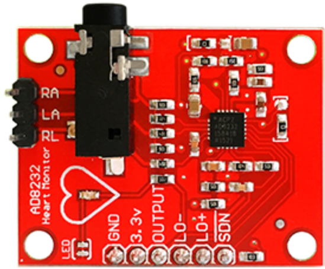

我们将把电路板上九个引脚中的五个连接到你的 Arduino 控制器。所需的五个引脚分别标注为 GND、3.3v、OUTPUT、LO - 和 LO+。

| 引脚 | 引脚功能 | Arduino 接口 |
| :--: | :--: | :--: |
| GND | 接地 | GND|
|3.3v|3.3v供电|3.3v|
|OUTPUT|输出信号|A0|
|LO-|导联脱落检测-|11|
|LO+|导联脱落检测+|10|
|SDN|关闭|未使用|

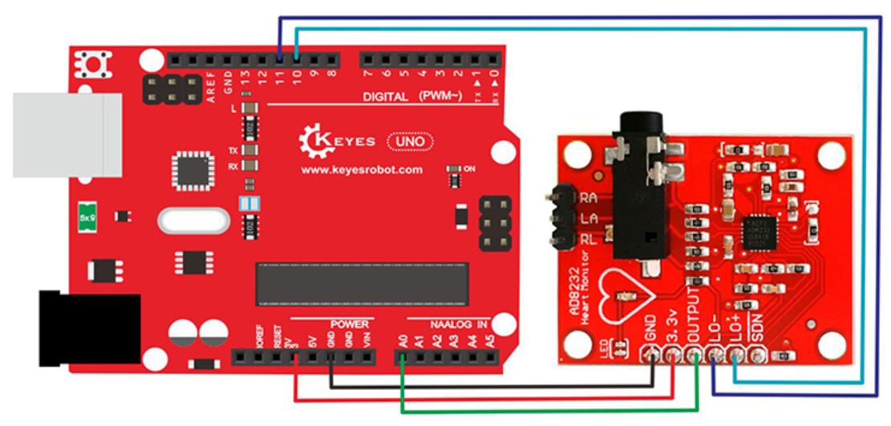

**感应贴片放置**

电子元件部分已组装完成，接下来我们来看感应贴片的放置方法。建议先将感应贴片卡接在导线上，再贴敷于人体表面。

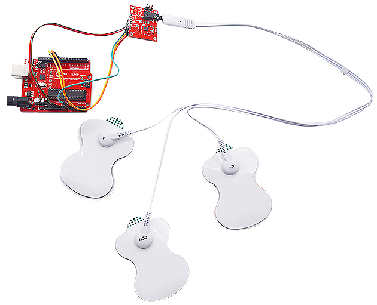

电极片越靠近心脏位置，测量效果越好。线缆采用L/R/COM的编码，可根据下表所示，参照艾因托芬三角理论确定正确的粘贴位置。传感器可按照左侧示意图所示，粘贴在前臂和腿部；也可按照右侧示意图所示，粘贴在靠近手臂的胸部位置以及右下腹上方（即右髋部正上方）。

| 编码 | 信号 |
| :--: | :--: |
| L | LA (左臂) | 
| R | RA (右臂) |
| COM |  肚子附近 |


## Arduino 示例

### 1. Arduino IDE下载安装

#### Windows 系统

**特别提醒：本教程采用的 Arduino IDE 版本是 2.3.8 。如果是其他版本的话，不能保证本教程提供的示例代码能编译和上传成功。** 

##### Arduino IDE下载 

我们先到Arduino官方的网站：[Software | Arduino](https://www.arduino.cc/en/software/) 下载 Arduino IDE。

Arduino 软件有很多版本，有Windows，Mac，Linux系统的（如下图），而且还有过去老的版本，你只需要下载一个适合自己计算机系统的版本即可。

这里是以下载 **Windows Win 10 or newer(64-bit)** 为例，你也可以根据自己所需，选择下载 **Windows ZIP file**。选择如下图。

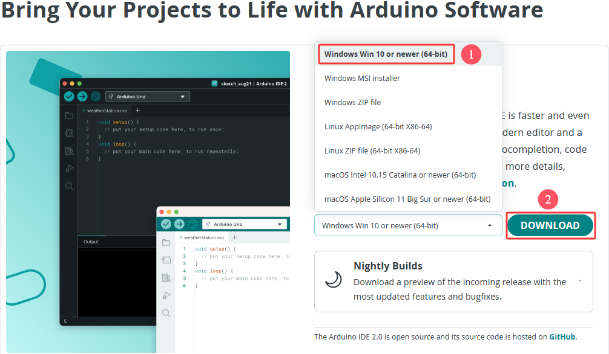

这里我们以Windows系统的为例给大家介绍下载和安装的步骤。Windows系统的也有两个版本，一个版本是安装版：Windows Win 10 or newer(64-bit) ；另一个是下载版：Windows ZIP file，是不用安装，直接下载文件到电脑，解压缩就可以用了。

##### Arduino IDE安装

1\. 保存从软件页面下载的.exe文件到硬盘驱动器，然后简单地运行该文件.

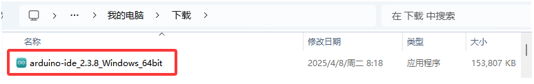

2\. 阅读许可协议并同意.

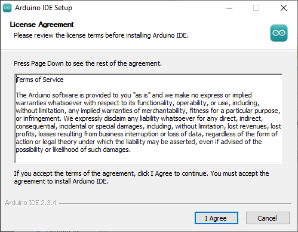

3\. 选择安装选项.

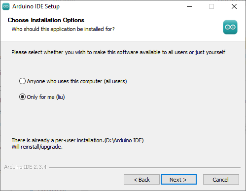

4\. 选择安装位置.

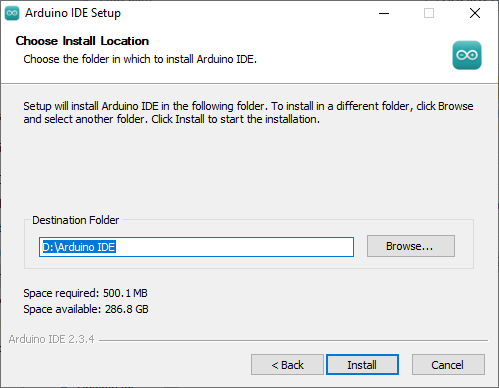

5\. 单击 "Finish" 并运行Arduino IDE

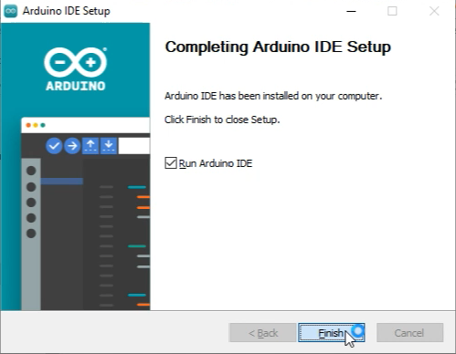

#### MacOS 系统

**特别提醒：本教程采用的 Arduino IDE 版本是 2.3.8 。如果是其他版本的话，不能保证本教程提供的示例代码能编译和上传成功。** 

##### Arduino IDE下载

我们先到Arduino官方的网站：[Software | Arduino](https://www.arduino.cc/en/software/) 下载 Arduino IDE。

不同的系统，需要下载不同的Arduino IDE，下载方式和Windows类似。这里是以下载 **macOS Intel 10.15 Catalina or newer(64-bit)** 为例，你也可以根据自己所需，选择下载 **macOS Apple Silicon 11 Big Sur or newer(64-bit)**。选择如下图。

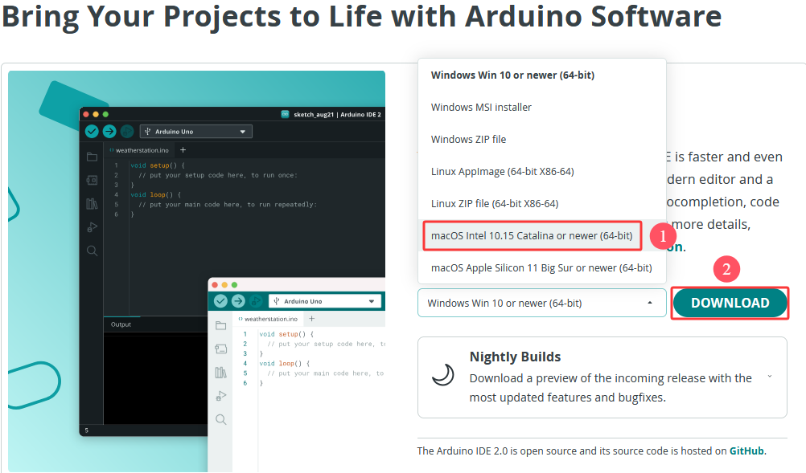

##### Arduino IDE安装

Arduino IDE下载之后，双击下载的`arduino_ide_xxxx.dmg`文件并按照说明将 **Arduino IDE.app** 复制粘贴到 **Applications** 文件夹，几秒钟后您将看到 Arduino IDE 安装成功.

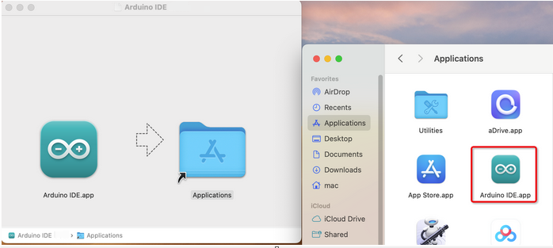


### 2. 设置Arduino IDE语言

⚠️ **特别提醒：Windows系统、MAC系统等不同系统，arduino IDE语言设置方法差不多，可以参考。**

1\. 首先打开Arduino IDE.

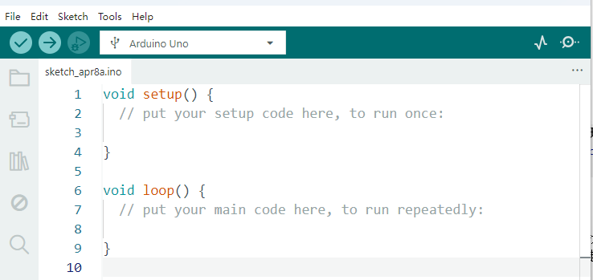

2\. 点击“**File** ——>**Preferences...**”，在**Preferences**对话框中，单击 “**English**” 按钮选择 “**中文(简体)**”，然后单击 “**OK**”.

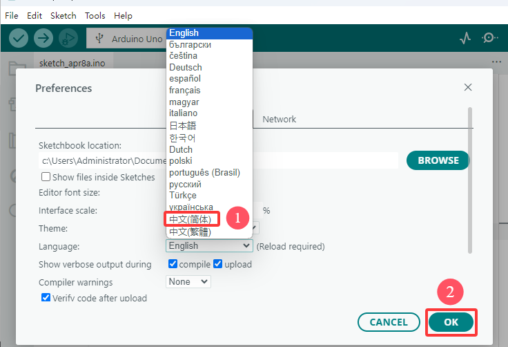

3\. 这样，arduino IDE的语言切换完成了，arduino IDE的语言为中文(简体)。

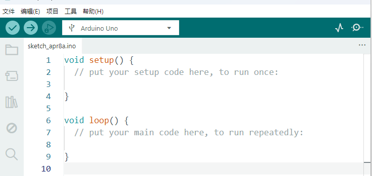

### 3. Arduino IDE说明

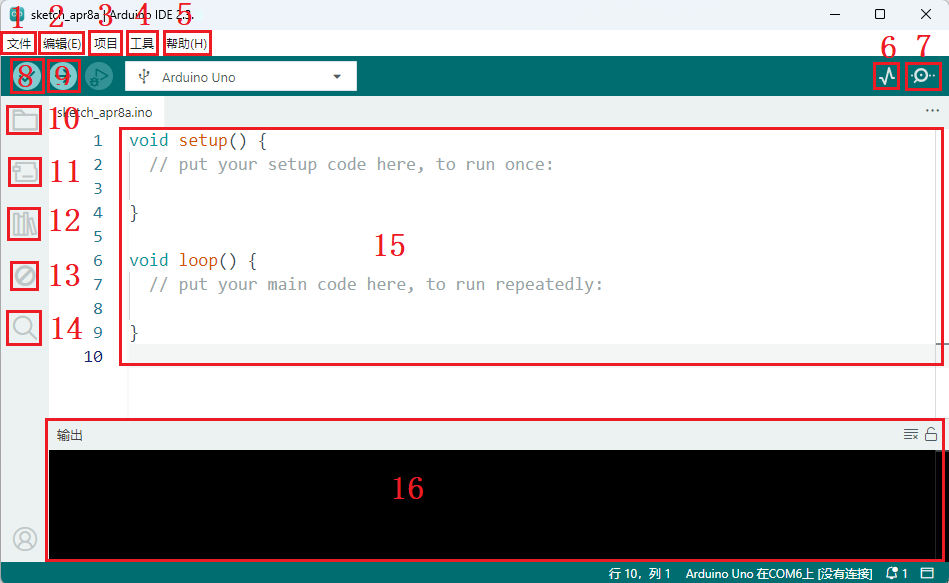

1\. “文件”：列表里面的功能有新建项目，打开程序，打开最近使用的代码，打开示例代码，关闭IDE，保存代码，首选项，高级设置等。

2\. “编辑”：列表里面的功能有复制，粘贴，自动格式化，字体大小等这个一般都是使用快捷键进行操作。（建议坚持使用快捷键，接触多了就水到渠成了）。

3\. “项目”：列明里面的常用功能有验证\编译代码，上传代码，导入库等。

4\. “工具”：列表里面的常用功能有开发板选择，端口选择，这两个很重要。

5\. “帮助”：点击这个可以查看IDE版本已经官方的参考文件。

6\. “串口绘图仪”：它会将串口的数据以折线图的样式显示出来。

7\. “串口监视器”：可以将我们需要查看的数据在这里进行打印显示。

8\. 验证程序按钮。

9\. 验证并上传程序按钮。

10\. “项目文件夹”：可以新建项目，还可以只有arduino Cloud进行同步和编辑。

11\. “开发板管理器”：可以添加或删除开发板。

12\. “库管理”：就要添加和删除库。

13\. “调试”：可以对代码进行监视与断点调试。

14\. 搜索框。

15\. 代码编辑区。

16\. IDE提示区（上传代码报错或成功）和串口监视器显示区

### 4. 安装驱动

1\. 使用USB数据线将开发板和电脑连接起来，如果开发板未被电脑识别，可能需要手动安装 Arduino 官方驱动。

2\. 驱动安装步骤：

(1). 将开发板通过 USB 数据线连接到电脑。

(2). 打开设备管理器，查看是否识别到开发板。

(3). 如果未识别，下载并安装 Arduino 官方驱动

A\. 点击官网链接：[https://www.keyesrobot.cn/zh-cn/latest](https://www.keyesrobot.cn/zh-cn/latest)

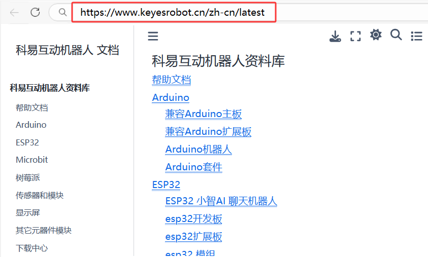

B\. 点击 “**下载中心**”，进入下载中心页面，向下滑找到 **驱动程序下载** 部分。

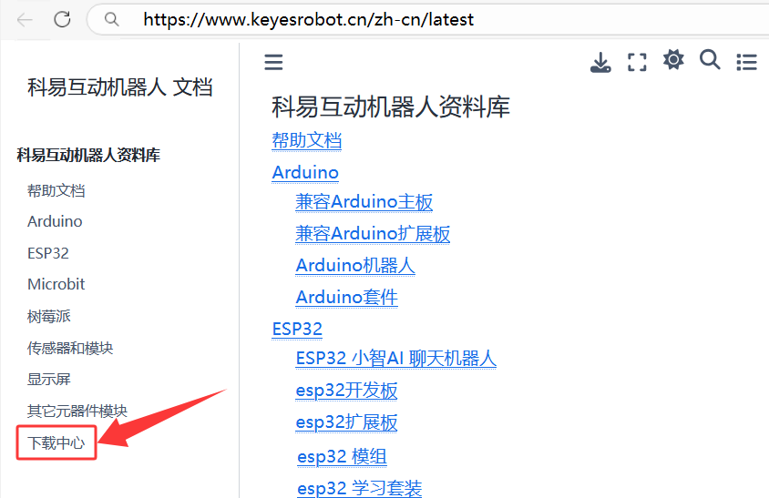

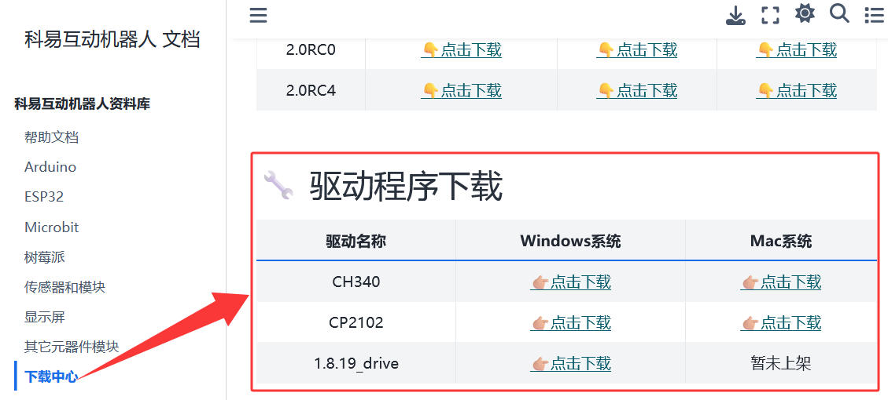

C\. 根据开发板的USB驱动芯片和电脑系统来选择下载安装对应的USB驱动。

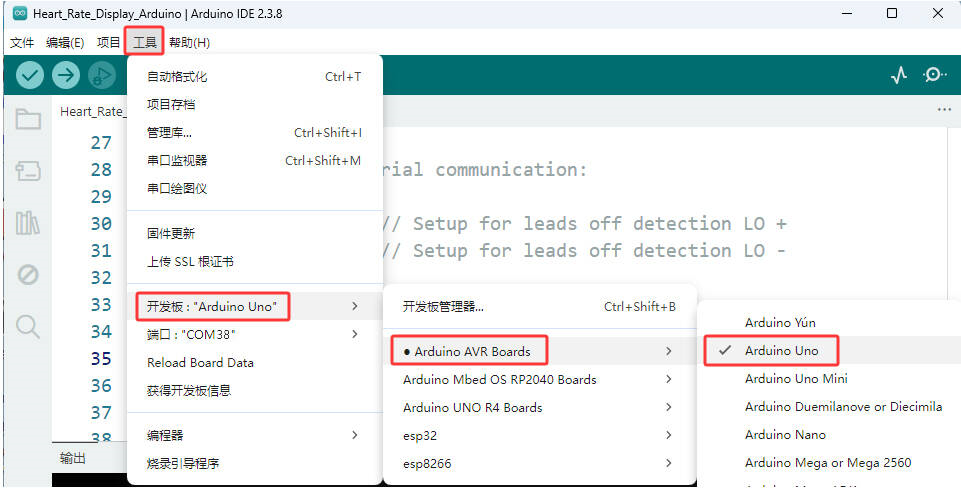

### 5. 示例代码

```C
/******************************************************************************
Heart_Rate_Display.ino
Demo Program for AD8232 Heart Rate sensor.
Casey Kuhns @ SparkFun Electronics
6/27/2014
https://github.com/sparkfun/AD8232_Heart_Rate_Monitor

The AD8232 Heart Rate sensor is a low cost EKG/ECG sensor.  This example shows
how to create an ECG with real time display.  The display is using Processing.
This sketch is based heavily on the Graphing Tutorial provided in the Arduino
IDE. http://www.arduino.cc/en/Tutorial/Graph

Resources:
This program requires a Processing sketch to view the data in real time.

Development environment specifics:
	IDE: Arduino 1.0.5
	Hardware Platform: Arduino Pro 3.3V/8MHz
	AD8232 Heart Monitor Version: 1.0

This code is beerware. If you see me (or any other SparkFun employee) at the
local pub, and you've found our code helpful, please buy us a round!

Distributed as-is; no warranty is given.
******************************************************************************/

void setup() {
  // initialize the serial communication:
  Serial.begin(9600);
  pinMode(10, INPUT); // Setup for leads off detection LO +
  pinMode(11, INPUT); // Setup for leads off detection LO -

}

void loop() {
  
  if((digitalRead(10) == 1)||(digitalRead(11) == 1)){
    Serial.println('!');
  }
  else{
    // send the value of analog input 0:
      Serial.println(analogRead(A0));
  }
  //Wait for a bit to keep serial data from saturating
  delay(1);
}
```

### 6. 实验结果

先点击“**工具**” --→ “**开发板**” --→ “**Arduino AVR Boards**” --→ “**Arduino Uno**”，再点击“**工具**” --→ “**端口**” --→ “**COMxx**”。请务必选择正确的开发板（例如 Arduino Uno）以及串口号。


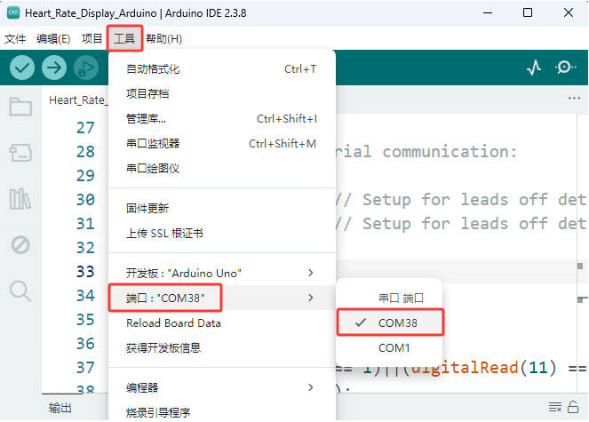

准备就绪后，点击上传按钮，将示例代码烧录到开发板中。

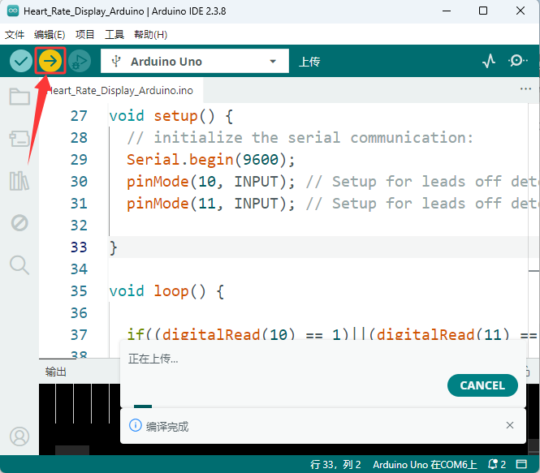


要验证心率监测仪是否正常工作，请以 9600 波特率打开串口监视器。你应能看到屏幕上打印出数值。以下是传感器连接在前臂和右腿时的输出示例。你的串行输出应在约 500 的中心值附近，在 + 300/-200 区间内出现峰值波动。

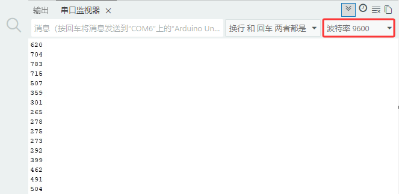

如果仅查看数值，串行数据很难直观呈现。若你使用的是 1.6.6 及以上版本的 Arduino IDE，可借助 Arduino 串行绘图器将数据以图表形式展示，这是其中一种方法。在 Arduino IDE 中，依次选择 “**工具**” > “**串行绘图器**”。当传感器放置正确且保持静止时，你会看到与下图类似的波形。

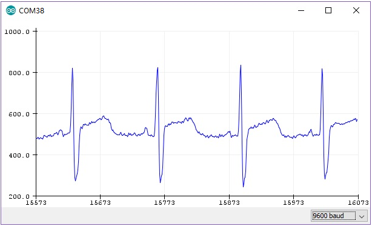

## Processing 示例

⚠️<span style="color: rgb(255, 76, 65);">**请注意：**</span> 此 Processing 代码仅供高级用户使用！编程新手建议直接使用 Arduino 串口绘图仪。若您具备编程经验且曾使用过 Processing，可继续操作。

### 1. 下载安装Processing IDE

点击链接下载：[https://pan.baidu.com/s/1jt1FmGEHetI5bQJCguwg9g?pwd=KEYE](https://pan.baidu.com/s/1jt1FmGEHetI5bQJCguwg9g?pwd=KEYE) 

提取码: KEYE

将Processing IDE v2.2.1 程序文件(压缩包)存放于自己方便的地方，这里是以将压缩包下载于电脑桌面上为例，你也可以将压缩包下载于其他磁盘里。

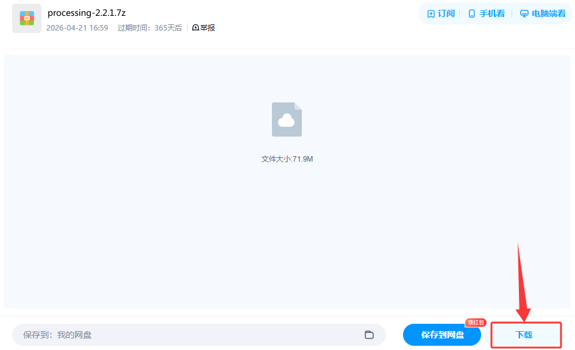


<span style="color: rgb(0, 209, 0);">**注：**</span> Processing 是一款可实现数据可视化等功能的软件。找到下载好的 Processing IDE v2.2.1 程序文件(压缩包)，将压缩包解压。

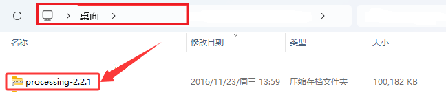

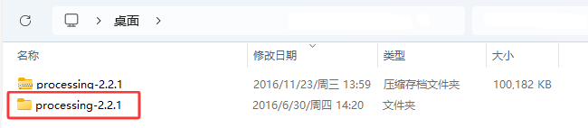

在Processing IDE v2.2.1文件夹可以找到对应的Processing IDE文件，点击它就可以打开Processing IDE。

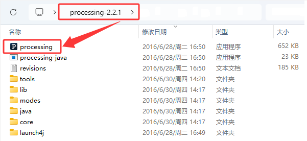

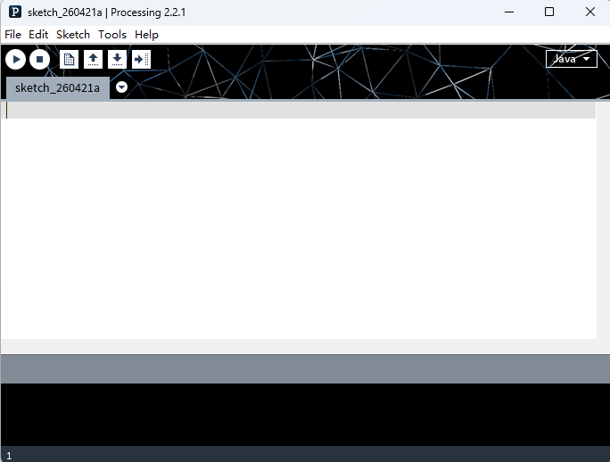

⚠️ <span style="color: rgb(255, 76, 65);">请注意：以下示例均基于 Processing IDE V2 版本设计，其他的版本不能保证是否兼容。</span>

### 2. 实验代码

这段 Processing 示例代码将为你提供另一种方式，直观呈现程序运行输出的具体情况。

```Processing
/******************************************************************************
Heart_Rate_Display.ino
Demo Program for AD8232 Heart Rate sensor.
Casey Kuhns @ SparkFun Electronics
6/27/2014
https://github.com/sparkfun/AD8232_Heart_Rate_Monitor

The AD8232 Heart Rate sensor is a low cost EKG/ECG sensor.  This example shows
how to create an ECG with real time display.  The display is using Processing.
This sketch is based heavily on the Graphing Tutorial provided in the Arduino
IDE. http://www.arduino.cc/en/Tutorial/Graph

Resources:
This program requires a Processing sketch to view the data in real time.

Development environment specifics:
	IDE: Arduino 1.0.5
	Hardware Platform: Arduino Pro 3.3V/8MHz
	AD8232 Heart Monitor Version: 1.0

This code is beerware. If you see me (or any other SparkFun employee) at the
local pub, and you've found our code helpful, please buy us a round!

Distributed as-is; no warranty is given.
******************************************************************************/

import processing.serial.*;

Serial myPort;        // The serial port
int xPos = 1;         // horizontal position of the graph
float height_old = 0;
float height_new = 0;
float inByte = 0;
int BPM = 0;
int beat_old = 0;
float[] beats = new float[500];  // Used to calculate average BPM
int beatIndex;
float threshold = 620.0;  //Threshold at which BPM calculation occurs
boolean belowThreshold = true;
PFont font;


void setup () {
  // set the window size:
  size(1000, 400);        

  // List all the available serial ports
  println(Serial.list());
  // Open whatever port is the one you're using.
  myPort = new Serial(this, Serial.list()[2], 9600);
  // don't generate a serialEvent() unless you get a newline character:
  myPort.bufferUntil('\n');
  // set inital background:
  background(0xff);
  font = createFont("Ariel", 12, true);
}


void draw () {
     //Map and draw the line for new data point
     inByte = map(inByte, 0, 1023, 0, height);
     height_new = height - inByte; 
     line(xPos - 1, height_old, xPos, height_new);
     height_old = height_new;
    
      // at the edge of the screen, go back to the beginning:
      if (xPos >= width) {
        xPos = 0;
        background(0xff);
      } 
      else {
        // increment the horizontal position:
        xPos++;
      }
      
      // draw text for BPM periodically
      if (millis() % 128 == 0){
        fill(0xFF);
        rect(0, 0, 200, 20);
        fill(0x00);
        text("BPM: " + inByte, 15, 10);
      }
}


void serialEvent (Serial myPort) 
{
  // get the ASCII string:
  String inString = myPort.readStringUntil('\n');

  if (inString != null) 
  {
    // trim off any whitespace:
    inString = trim(inString);

    // If leads off detection is true notify with blue line
    if (inString.equals("!")) 
    { 
      stroke(0, 0, 0xff); //Set stroke to blue ( R, G, B)
      inByte = 512;  // middle of the ADC range (Flat Line)
    }
    // If the data is good let it through
    else 
    {
      stroke(0xff, 0, 0); //Set stroke to red ( R, G, B)
      inByte = float(inString); 
      
      // BPM calculation check
      if (inByte > threshold && belowThreshold == true)
      {
        calculateBPM();
        belowThreshold = false;
      }
      else if(inByte < threshold)
      {
        belowThreshold = true;
      }
    }
  }
}
  
void calculateBPM () 
{  
  int beat_new = millis();    // get the current millisecond
  int diff = beat_new - beat_old;    // find the time between the last two beats
  float currentBPM = 60000 / diff;    // convert to beats per minute
  beats[beatIndex] = currentBPM;  // store to array to convert the average
  float total = 0.0;
  for (int i = 0; i < 500; i++){
    total += beats[i];
  }
  BPM = int(total / 500);
  beat_old = beat_new;
  beatIndex = (beatIndex + 1) % 500;  // cycle through the array instead of using FIFO queue
  }
```

### 3. 实验结果

该示例 Processing 程序可在 Processing IDE 2.2.1 版本中正常运行，更高版本可能无法兼容此示例代码。准备就绪后，点击 “” 按钮。


这个 Processing 程序草图一开始很可能无法正常运行，你大概率会看不到任何绘制出的内容。

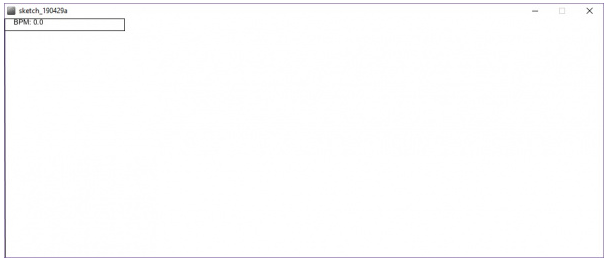

如果屏幕上没有显示任何内容，很可能是因为 Processing 程序没有读取到正确的串口。出现这种情况时，请务必修改下面这行代码。

```Processing
myPort = new Serial(this, Serial.list()[2], 9600);
```
你需要根据电脑上枚举的 COM 端口，修改 Serial.list ()[N] 中的参数。可用的 COM 端口列表会显示在程序窗口的下方。请注意，COM 端口的选择从 0 开始计数，也就是说你需要从左到右、以编程逻辑（而非数学逻辑）从 0 开始对每个 COM 端口进行计数。在本案例中，上传时 Arduino 被识别为 COM38，因此它应位于数组的第 3 个元素位置。所以，你需要将数值修改为 2，示例代码相应地写为 Serial.list ()[2]。通常情况下，如果你的电脑仅连接了 Arduino 这一个设备，它会显示为编号最大的 COM 端口。

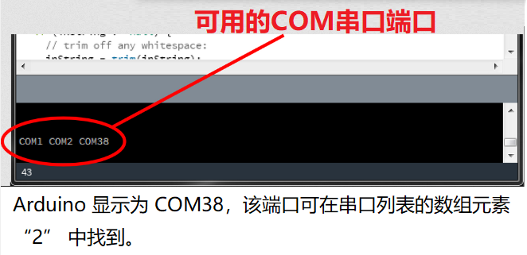

在根据你的设备配置调整好 COM 端口后，再次点击运行按钮。如果一切运行正常，你会看到一个美观的弹窗出现，并开始显示与下图类似的输出信号。

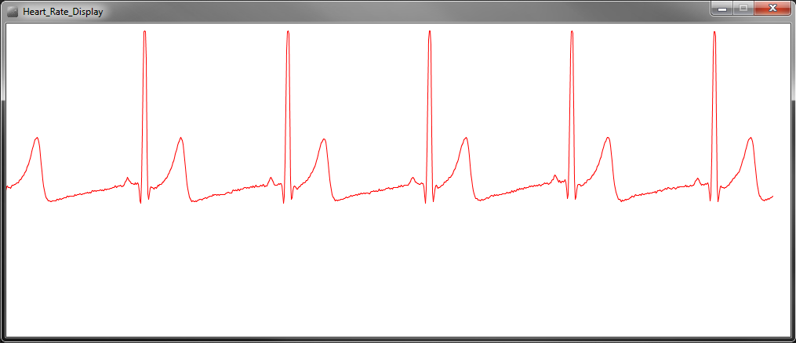

如果你的实验对象决定移除传感器，代码中的导联脱落检测功能就会启动，并显示一条平直的蓝色线条。


## 故障排查与实用技巧

心电图信号极易产生噪声，这是因为测量过程中会同时捕捉到肌肉的电活动。传感器贴片距离心脏越远，所采集到的肌肉噪声就越多，这类干扰通常被称为 “运动伪影”。以下是几条提升信号质量的简易技巧：

- 尽可能将传感器贴片贴近心脏位置。

- 确保右肩（RA）与左肩（LA）传感器贴片分别贴在心脏对应正确的一侧。
- 测量过程中尽量减少身体活动。
- 每次测量尽量使用全新的贴片，贴片经多次粘贴后信号传导能力会下降。
- 提前清洁准备粘贴贴片的皮肤区域，以保证良好接触（毛发并非良好的导电介质）。
- 针对不同人群，可能需要适当调整传感器的粘贴位置。

若传感器贴片在身体上放置不当或线缆未正确连接，在串口监视器中可能会出现类似下图的输出结果：波形数值会被限制在 0 至 1023 之间，或直接显示 “!” 符号。


因此，你要么会在 Arduino 串口绘图仪中看到一条平直的线条，要么在 Processing 的显示窗口中什么都不会绘制出来。如果出现这种情况，你需要检查焊点，并尝试将传感器贴片放置在身体的其他位置。

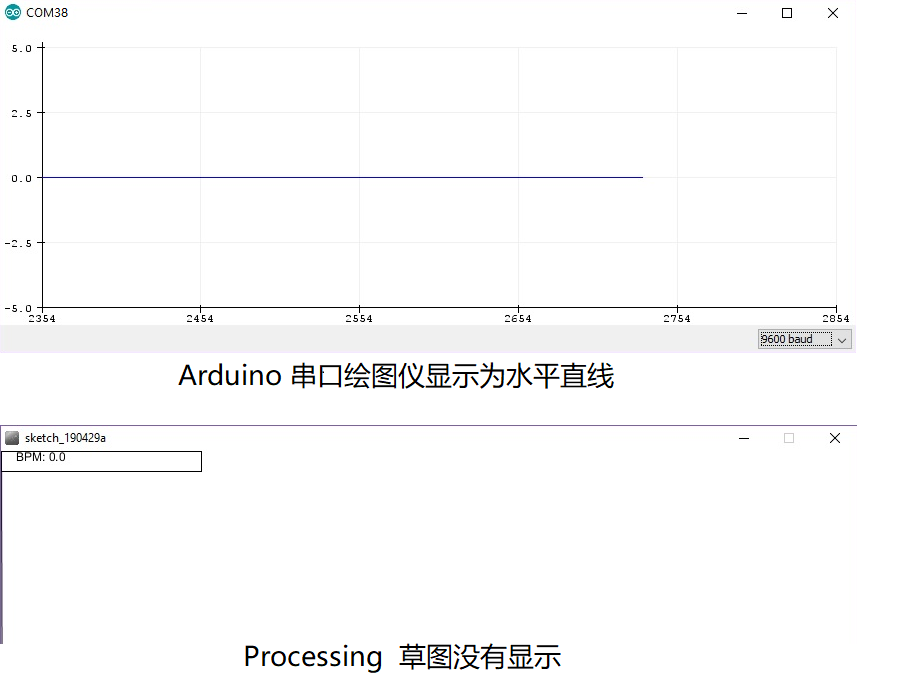

如果你频繁移动或活动肌肉，就无法获得清晰的波形。在传感器进行测量时，请保持静止并放松。你可能会看到少量清晰的波形，但结果可靠性会下降。

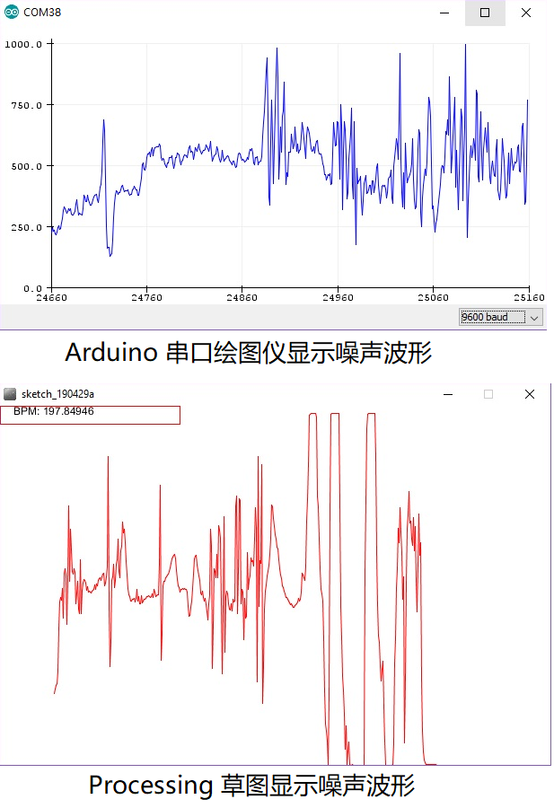

根据传感器贴片放置位置的不同，你可能仍会得到清晰的波形，其形态与下方 Arduino 串行绘图仪中显示的图表相近。你或许会注意到，即便中心数值存在噪声干扰，QT 间期依然会呈现出规律性的搏动。这种效果不如此前展示的波形理想，可根据实际应用场景，将贴片调整至其他位置。进一步观察下面第二张图表时，你会发现在波形末端出现一个逐渐上升的尖峰。这是因为传感器捕捉到了使用者深呼吸时产生的身体动作，该现象与使用者大幅活动或肌肉收缩时的情况类似。若出现此类情况，请注意保持自然呼吸，不要刻意用力。

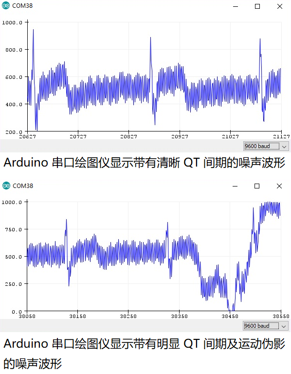
